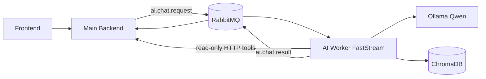
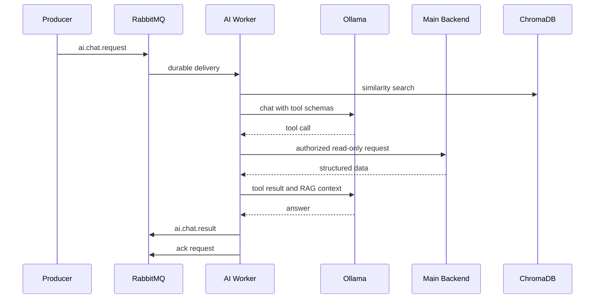
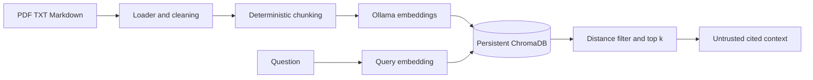

# AI Service для умного кредитного кабинета предпринимателя

Самостоятельный локальный AI-микросервис конкурсного MVP. Сервис принимает чат-задачи через
RabbitMQ, вызывает Qwen в Ollama, получает актуальные структурированные данные через разрешённые
HTTP-инструменты Main Backend и дополняет ответы справочным контекстом из ChromaDB. Все данные и
кредитные продукты в репозитории синтетические и не являются предложениями Альфа-Банка.

## Архитектура



Main Backend остаётся источником истины для профиля, каталога, заявок, прав и истории. AI Service
не подключается к PostgreSQL, не меняет заявку, не отправляет её и не принимает кредитное решение.
В самостоятельном демо роль Main Backend выполняет `mock_backend`. Корневой `./start.sh` запускает
интегрированный контур с настоящим backend (`BACKEND_CONTRACT=main`); см.
[контракт подключения](docs/backend_integration.md). В интегрированном контуре one-shot сервис
`ai-ingest` перед запуском worker идемпотентно индексирует семь TXT из
`rag_demo_credit_cabinet/documents` в общий persistent Chroma volume.





## Компоненты и структура

- `app/api` — `/health`, `/ready` и сборка зависимостей.
- `app/messaging` — durable exchanges/queues, ручные подтверждения, ограниченные retry и DLQ.
- `app/agent` — управление контекстом и цикл реального Ollama tool calling.
- `app/tools` — явный allow-list из семи read-only инструментов с Pydantic-валидацией, включая
  подготовленный `get_scoring_result` для сохранённых Backend ML-оценок.
- `app/rag` — загрузка PDF/TXT/Markdown, chunking, embeddings, ChromaDB и retrieval.
- `mock_backend` — синтетические профили, продукты, заявки, ACL и OpenAPI.
- `knowledge_base` — согласованная с Mock Backend демонстрационная база знаний.
- `rag_demo_credit_cabinet` — отдельный корпус и eval-набор для интегрированного Main Backend.
- `scripts` — индексация, producer, consumer и сквозной smoke test.
- `tests` — быстрые unit-тесты и отдельно включаемые внешние integration-тесты.
- `evaluation/dataset.jsonl` — основной набор сценариев выбора инструментов и groundedness;
  `evaluation/scoring_dataset.jsonl` — 10 сценариев безопасного объяснения ML Scoring.
- `docs` — контракты интеграции, надёжность очереди и ограничения MVP.

Готовая коллекция ручных HTTP-проверок находится в `docs/postman_collection.json`.

## Системные требования

- macOS на Apple Silicon или Linux, Docker Desktop / Docker Engine;
- Python 3.11–3.13 и `uv` для запуска вне Docker;
- Ollama 0.33.3 или совместимая версия;
- ориентировочно 10–12 ГБ свободной памяти для Qwen 7B и сервисов.

Версии ключевых Python-библиотек зафиксированы в `pyproject.toml` и `uv.lock`. На macOS Ollama
запускается нативно, чтобы использовать Metal; контейнеры обращаются к ней через
`host.docker.internal:11434`.

## Быстрый запуск на macOS

1. Подготовьте модели и убедитесь, что Ollama отвечает:

   ```bash
   ollama serve
   ollama pull qwen2.5:7b-instruct
   ollama pull qwen3-embedding:0.6b
   ollama list
   ```

   Для эксперимента можно установить `OLLAMA_LLM_MODEL=qwen3.5:4b`; одновременно две LLM сервис
   не загружает.

2. Создайте локальную конфигурацию:

   ```bash
   cp .env.example .env
   ```

3. Запустите инфраструктуру и приложения:

   ```bash
   docker compose up --build -d rabbitmq mock-backend ai-api ai-worker
   docker compose ps
   ```

4. Проиндексируйте демонстрационную базу знаний:

   ```bash
   docker compose run --rm ai-api uv run python -m scripts.ingest
   ```

5. Проверьте полный сценарий:

   ```bash
   docker compose run --rm ai-api uv run python -m scripts.smoke_test
   ```

RabbitMQ Management доступен по `http://localhost:15672` (`guest` / `guest` только для локальной
разработки), Mock Backend OpenAPI — по `http://localhost:8090/docs`, AI Service OpenAPI — по
`http://localhost:8080/docs`.

## Запуск без Docker

```bash
uv sync --all-groups
cp .env.example .env
uv run uvicorn mock_backend.main:app --host 0.0.0.0 --port 8090
uv run uvicorn app.main:app --host 0.0.0.0 --port 8080
uv run faststream run app.messaging.worker:app
```

Локальный RabbitMQ всё равно требуется. После первого запуска выполните `uv run ai-ingest`.

## Portable Demo

Для машины, где нативной Ollama нет, предусмотрен контейнерный профиль:

```bash
docker compose -f docker-compose.yml -f docker-compose.portable.yml up --build -d
docker compose -f docker-compose.yml -f docker-compose.portable.yml exec ollama \
  ollama pull qwen2.5:7b-instruct
docker compose -f docker-compose.yml -f docker-compose.portable.yml exec ollama \
  ollama pull qwen3-embedding:0.6b
```

CPU-инференс заметно медленнее. На Apple Silicon основной и рекомендуемый сценарий — нативная
Ollama. Не задавайте `OLLAMA_HOST=0.0.0.0` без сетевой изоляции: это откроет API модели другим
устройствам сети.

## Проверки

```bash
uv run ruff check .
uv run pytest
uv run pytest --cov=app --cov=mock_backend
RUN_EXTERNAL_INTEGRATION=1 uv run pytest -m ollama
curl -fsS http://localhost:8080/health
curl -i http://localhost:8080/ready
```

Быстрые тесты используют fake LLM и embeddings, поэтому не требуют Ollama. Внешние тесты явно
включаются переменной `RUN_EXTERNAL_INTEGRATION=1`.

Для ручной проверки RabbitMQ можно запустить consumer, затем producer:

```bash
uv run faststream run scripts.result_consumer:app
uv run python -m scripts.producer "Какие кредиты подходят моему ИП?"
```

Для проверки RAG повторно выполните `uv run ai-ingest` — старые чанки документа удаляются перед
upsert, поэтому дубликаты не накапливаются. Источники возвращаются в `sources` результата.

Локальная AI-оценка на 40 синтетических сценариях запускается после старта Mock Backend и
индексации:

```bash
uv run python evaluation/run.py
```

Отчёт содержит модель, параметры, SHA-256 системного prompt и dataset, задержку, выбранные
инструменты и результаты проверок. Для точечного regression можно передать `--ids id1,id2`.

## Контракты сообщений

Запрос публикуется в `ai.events` с routing key `ai.chat.request`:

```json
{
  "schema_version": "1.0",
  "request_id": "uuid",
  "conversation_id": "uuid",
  "user_id": "uuid",
  "organization_id": "uuid",
  "message": "Какие кредиты подходят моему ИП?",
  "history": [],
  "application_id": null,
  "trusted_context": {
    "subject": "authenticated-subject",
    "roles": ["entrepreneur"],
    "authorization": "Bearer short-lived-token"
  },
  "created_at": "2026-10-20T09:00:00Z"
}
```

Результат публикуется с routing key `ai.chat.result` и тем же correlation ID. Main Backend обязан
дедуплицировать его по `request_id`. Полные схемы и требования к авторизации описаны в
`docs/backend_integration.md` и `docs/api_contracts.md`.

## Tool Calling и безопасность

Модель получает только схемы `get_user_profile`, `search_credit_products`, `get_product_details`,
`get_application_status`, `get_required_documents`, `validate_application` и подготовленный
`get_scoring_result`. Реестр отклоняет неизвестные функции и лишние аргументы. Пользователь и
организация никогда не берутся из tool arguments: клиент передаёт доверенные идентификаторы и токен
из проверенного сообщения, а backend снова проверяет ACL. RAG-текст помечается как недоверенный,
число tool-циклов ограничено. Реальный Scoring API пока должен быть реализован Main Backend; текущая
AI-интеграция проверена на mock HTTP responses.

## Надёжность

Очереди и exchanges durable, публикации persistent, обработчик подтверждает сообщение вручную
только после публикации результата или контролируемого retry. Временные ошибки имеют конечное число
попыток через TTL retry queue; неизвестные ошибки уходят в DLQ без бесконечного requeue. Семантика
доставки — at-least-once. Подробности и сбойные сценарии находятся в `docs/reliability.md`.

## Ограничения MVP и интеграция

- Все продукты, ставки, профили и заявки синтетические.
- Встроенный ChromaDB рассчитан на один worker; для горизонтального масштабирования потребуется
  общий Chroma server или другое сетевое векторное хранилище.
- Глобальная concurrency равна 1, поэтому порядок текущего демо стабилен. Перед масштабированием
  нужен partition/lock по `conversation_id`.
- Историю постоянно хранит Main Backend; память worker не является хранилищем диалога.
- Формальная валидация не является скорингом или решением банка.
- Для production нужны mTLS/сервисная идентификация, секрет-хранилище, централизованная
  наблюдаемость и согласованный механизм проверки подписи доверенного контекста.

Точки замены Mock Backend на настоящий перечислены в `docs/backend_integration.md`; логика
оркестратора при этом не меняется, достаточно совместимого API и конфигурации URL/токена.
