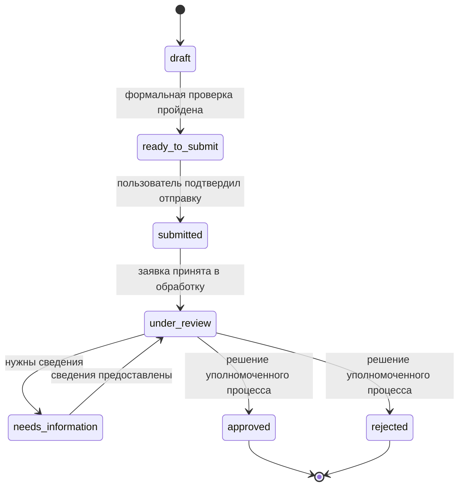

# Демонстрационные состояния кредитной заявки

AI Service только читает и объясняет состояние. Переходы выполняет Main Backend после проверки прав
и бизнес-правил.

Демонстрационная формальная валидация проверяет только заполненность и комплектность. Она не
является скорингом и не переводит заявку в `approved` или `rejected`.

