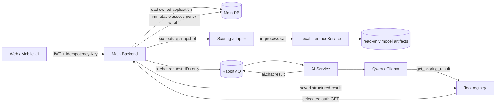

# Контракт интеграции ML Scoring с Main Backend и AI Service

Статус: проект для согласования, API ещё не реализован. Версия контракта: `1.0`.

## 1. Цель и принятые решения

Для MVP `ml_scoring` подключается как локальный Python-компонент Main Backend. Main Backend остаётся
единственным владельцем заявок, организаций, авторизации, persistence и audit trail. AI Service не
загружает модель и получает только уже сохранённый результат через read-only tool.

Основные решения:

- первичная оценка создаётся по `application_id`; клиент не присылает отдельную копию ML-признаков;
- Backend формирует неизменяемый snapshot шести признаков из конкретной версии своей заявки;
- расчёт синхронный, поскольку локальная Logistic Regression мала; результат сохраняется до ответа;
- assessment и What-if неизменяемы, повторный расчёт создаёт новую запись;
- What-if не меняет заявку и всегда вызывает полный inference;
- score не является решением `approved/declined`;
- Qwen читает результат из Backend и никогда не вычисляет его самостоятельно.

Проверка текущего репозитория не выявила конфликтов маршрутов. Mock Backend использует
`/api/v1/profile`, `/api/v1/credit-products/*` и `/api/v1/applications/*`; namespace
`/api/v1/scoring/*` свободен. Реальный Main Backend находится в другом репозитории, поэтому его
глобальные router prefixes и зарезервированные маршруты должен дополнительно подтвердить его
разработчик.

## 2. Архитектурная схема



В durable RabbitMQ-сообщение не помещаются feature snapshot, полные результаты scoring, документы
или новые секреты. При необходимости контекста передаются только `assessment_id` и `what_if_id`, а
актуальные разрешённые данные AI Service получает через Backend tool API.

## 3. Границы ответственности

| Компонент | Отвечает | Не отвечает |
|---|---|---|
| Main Backend | аутентификация, tenant isolation, mapping заявки в шесть признаков, вызов ML, persistence, idempotency, audit | интерпретация текста через LLM |
| `ml_scoring` | строгая feature-валидация, SHA-256, preprocessing, `predict_proba`, точные вклады, What-if | пользователи, роли, БД, HTTP, кредитное решение |
| AI Service | проверенный tool calling, диалог, безопасная формулировка, RabbitMQ | вычисление score, изменение assessment, обход Backend ACL |
| Qwen | объяснение полученных факторов и ограничений | новые числовые вклады, прогноз, решение банка, формальная валидация |
| RAG | справочные сведения о продуктах и требованиях | значения score и факторы конкретной заявки |

## 4. Общие правила HTTP API

Base path: `/api/v1/scoring`. JSON использует UTF-8, timestamps — ISO 8601 UTC с `Z`. Идентификаторы
— UUID. Денежные поля Backend хранит как `Decimal`; преобразование в `float` происходит только в
ML-adapter после проверки диапазона.

Обязательные заголовки для пользовательского вызова:

```text
Authorization: Bearer <user access token>
Idempotency-Key: <UUID>          # для обоих POST
X-Request-ID: <UUID>             # рекомендуется; Backend создаёт его при отсутствии
Content-Type: application/json
```

Backend выводит `user_id`, `organization_id` и роли из проверенного токена/сессии. Переданные
клиентом `X-User-ID` и `X-Organization-ID` не являются источником авторизации. Статические заголовки
Mock Backend допустимы только в локальном демо.

Для AI Service дополнительно нужна workload identity (mTLS или короткоживущий service token) и
user-delegated token с audience Main Backend. Доступ разрешается только пересечением service scope,
делегированной роли и организации пользователя.

## 5. Общие модели ответа

### 5.1. Scoring result

```json
{
  "assessment_id": "71000000-0000-0000-0000-000000000001",
  "application_id": "30000000-0000-0000-0000-000000000001",
  "application_version": 7,
  "schema_version": "1.0",
  "status": "completed",
  "model": {
    "model_id": "synthetic-credit-logreg",
    "model_version": "1.0",
    "family": "logistic_regression",
    "bundle_sha256": "0c393f9b54d4b50d28a9c01d3d4f1343aa99af55edf044c8e11192e846702fe3"
  },
  "demonstration_only": true,
  "score": {
    "name": "synthetic_model_score",
    "value": 0.7257224270636591,
    "display_percent": 72.57
  },
  "explanation": {
    "baseline": {
      "method": "mean_in_transformed_train_space",
      "logit": 0.28355965013436724,
      "reference_version": "1.0",
      "reference_sha256": "771a4e7f6933a5e7794580be61208b7e49d953660f614d5c7c47b8c66f37d9f6"
    },
    "factors": [
      {
        "feature": "loan_amount",
        "display_name": "Сумма кредита",
        "input_value": 3000000.0,
        "baseline_value": 1084206.829326128,
        "logit_contribution": -1.1700180706736214,
        "direction": "negative",
        "rank": 1
      },
      {
        "feature": "credit_history",
        "display_name": "Кредитная история",
        "input_value": "good",
        "baseline_value": {
          "good": 0.37285714285714283,
          "average": 0.31792857142857145,
          "bad": 0.13135714285714287,
          "none": 0.17785714285714285
        },
        "logit_contribution": 0.8152244440174612,
        "direction": "positive",
        "rank": 2
      }
    ],
    "consistency": {
      "model_logit": 0.9730269763260238,
      "contribution_sum": 0.6894673261916567,
      "reconstructed_logit": 0.973026976326024,
      "reconstruction_error": 2.220446049250313e-16
    }
  },
  "limitations_warning": "Демонстрационная ML-оценка обучена на синтетических данных и не является банковской вероятностью одобрения, кредитным решением или гарантией результата.",
  "calculated_at": "2026-10-22T10:15:30.123Z",
  "selected_what_if": null
}
```

В реальном ответе `factors` содержит ровно шесть исходных факторов. `logit_contribution` — вклад в
logit относительно baseline, не изменение вероятности в процентных пунктах. Поле `value` напрямую
соответствует локальному `score.probability`; переименование выполняет только HTTP-adapter.

`explanation.consistency` нужно хранить для аудита, но UI может его не отображать. Backend обязан
сохранить полный числовой результат без повторного округления; `display_percent` округляется до двух
знаков только для UI.

### 5.2. Problem Details

Ошибки используют `application/problem+json`:

```json
{
  "type": "https://example.local/problems/scoring/unsupported-range",
  "title": "Application is outside the supported scoring range",
  "status": 422,
  "code": "SCORING_UNSUPPORTED_RANGE",
  "detail": "A confident demonstration score was not produced.",
  "instance": "/api/v1/scoring/assessments",
  "request_id": "72000000-0000-0000-0000-000000000001",
  "errors": [
    {
      "field": "annual_revenue",
      "message": "value is outside the generator-supported range",
      "supported_minimum": 300000.0,
      "supported_maximum": 120000000.0
    }
  ]
}
```

Стабильным контрактом является `code`; человекочитаемые тексты можно менять и локализовать.

## 6. `POST /api/v1/scoring/assessments`

### Назначение

Создать и сохранить новую демонстрационную оценку неизменяемой версии заявки. Main Backend сначала
проверяет доступ к заявке, затем сам извлекает шесть признаков. Это исключает расхождение между
заявкой и переданным клиентом feature payload.

### Запрос

```json
{
  "application_id": "30000000-0000-0000-0000-000000000001",
  "expected_application_version": 7
}
```

`expected_application_version` рекомендуется UI для optimistic concurrency. При несовпадении
Backend возвращает `409 APPLICATION_VERSION_CONFLICT`, а не оценивает другую версию молча.

### Алгоритм и сохранение

1. Проверить токен, роль `scoring:write` и принадлежность заявки организации.
2. Выполнить формальную проверку обязательных полей заявки.
3. Сформировать snapshot ровно из шести ML-полей; `age` и target туда не включать.
4. Зафиксировать `application_version` и SHA-256 канонического snapshot.
5. Выполнить `LocalInferenceService.score()` вне длительной DB-транзакции.
6. В транзакции повторно проверить версию заявки и вставить immutable assessment.
7. Записать audit event и вернуть `201 Created` с `Location` на GET endpoint.

При повторе того же `Idempotency-Key` и того же request fingerprint возвращается исходный ответ без
нового inference (`200 OK` допустим для replay). Та же key с другим fingerprint возвращает `409
IDEMPOTENCY_KEY_REUSED`.

### Ответы

- `201` — создан `ScoringAssessmentResponse` из раздела 5;
- `200` — идемпотентное воспроизведение ранее созданного результата;
- `404` — заявка отсутствует или принадлежит другой организации;
- `409` — изменилась версия заявки или конфликт idempotency;
- `422` — формально неполная/невалидная заявка либо `unsupported_range` без score;
- `503` — модель не загрузилась, несовместима или не прошла integrity check.

## 7. `GET /api/v1/scoring/assessments/{assessment_id}`

### Назначение

Получить сохранённый результат без повторного inference. Endpoint используется UI и будущим
`get_scoring_result`.

Опциональный query parameter `what_if_id=<UUID>` возвращает тот же assessment и заполняет
`selected_what_if` сохранённой симуляцией. Без параметра `selected_what_if` равен `null`. Это
позволяет Qwen объяснять конкретный What-if без добавления четвёртого маршрута.

### Авторизация и tenant isolation

Backend ищет assessment одновременно по `assessment_id` и текущему `organization_id`. Чужой и
несуществующий ID одинаково возвращают `404`. Затем проверяется доступ пользователя к связанной
заявке. Переданный `what_if_id` должен принадлежать и assessment, и той же организации.

### Семантика

- GET не запускает модель и не обновляет timestamps;
- сохранённые model/schema versions не заменяются текущими deployment-версиями;
- `Cache-Control: private, no-store` для MVP;
- ETag допустим по хешу immutable response;
- `200` возвращает модель из раздела 5, `404` скрывает чужой ресурс.

## 8. `POST /api/v1/scoring/assessments/{assessment_id}/what-if`

### Назначение

Создать неизменяемую модельную симуляцию от feature snapshot исходного assessment. Исходная заявка
и исходный assessment не изменяются.

### Запрос

```json
{
  "changes": {
    "loan_amount": 1500000.0
  }
}
```

`changes` допускает только шесть модельных полей и требует хотя бы одно реально изменённое значение.
Лишние поля, `age`, `approved`, `null`, NaN/inf и нестрогие типы запрещены. После merge с исходным
snapshot альтернативная анкета проходит полную Pydantic- и range-валидацию.

### Ответ

```json
{
  "what_if_id": "73000000-0000-0000-0000-000000000001",
  "assessment_id": "71000000-0000-0000-0000-000000000001",
  "schema_version": "1.0",
  "simulation_only": true,
  "changed_fields": ["loan_amount"],
  "original": {
    "score": {"name": "synthetic_model_score", "value": 0.4144714955491513, "display_percent": 41.45},
    "factors": []
  },
  "alternative": {
    "score": {"name": "synthetic_model_score", "value": 0.6109552629501994, "display_percent": 61.1},
    "factors": []
  },
  "delta_percentage_points": 19.6484,
  "limitations_warning": "What-if — только повторный расчёт модели для изменённой анкеты и не гарантия изменения решения банка.",
  "calculated_at": "2026-10-22T10:20:00.000Z"
}
```

В фактическом ответе `original.factors` и `alternative.factors` содержат полные шесть факторов;
пустые массивы выше сокращают пример. `delta_percentage_points` — единственное поле в процентных
пунктах. Вклады факторов по-прежнему выражены в logit.

Backend загружает исходный snapshot, применяет `changes` к копии, вызывает `score()` для обеих анкет
и сохраняет What-if с model hash исходного assessment. Если текущий process не обслуживает эту
версию модели, он не должен незаметно применить новую модель: возвращается `409
SCORING_MODEL_VERSION_UNAVAILABLE` или запрос маршрутизируется к совместимому deployment.

Ответы: `201/200` для create/replay, `404` для чужого assessment, `409` для недоступной версии,
`422 SCORING_NO_CHANGED_FIELDS`, `SCORING_INVALID_INPUT` или `SCORING_UNSUPPORTED_RANGE`, `503` для
временной недоступности scoring runtime.

## 9. Предлагаемые Pydantic-схемы Backend

Ниже — ориентир для реализации; authoritative wire schema находится также в
`backend_integration_openapi.yaml`.

```python
from datetime import datetime
from decimal import Decimal
from typing import Literal
from uuid import UUID

from pydantic import BaseModel, ConfigDict, Field, model_validator


class AssessmentCreate(BaseModel):
    model_config = ConfigDict(extra="forbid")
    application_id: UUID
    expected_application_version: int | None = Field(default=None, ge=1)


class WhatIfChanges(BaseModel):
    model_config = ConfigDict(extra="forbid", strict=True, allow_inf_nan=False)
    annual_revenue: Decimal | None = Field(default=None, gt=0)
    credit_history: Literal["good", "average", "bad", "none"] | None = None
    business_age_months: int | None = Field(default=None, ge=0)
    loan_amount: Decimal | None = Field(default=None, gt=0)
    has_collateral: bool | None = None
    loan_term_months: Literal[6, 12, 18, 24, 36, 48, 60] | None = None

    @model_validator(mode="after")
    def at_least_one_change(self):
        if not self.model_fields_set:
            raise ValueError("at least one changed field is required")
        return self


class WhatIfCreate(BaseModel):
    model_config = ConfigDict(extra="forbid")
    changes: WhatIfChanges


class Score(BaseModel):
    name: Literal["synthetic_model_score"]
    value: float = Field(ge=0, le=1)
    display_percent: float = Field(ge=0, le=100)


class Factor(BaseModel):
    feature: Literal[
        "annual_revenue", "credit_history", "business_age_months",
        "loan_amount", "has_collateral", "loan_term_months",
    ]
    display_name: str
    input_value: float | int | bool | str
    baseline_value: float | dict[str, float]
    logit_contribution: float
    direction: Literal["positive", "negative", "neutral"]
    rank: int = Field(ge=1, le=6)


class AssessmentResponse(BaseModel):
    assessment_id: UUID
    application_id: UUID
    application_version: int
    schema_version: Literal["1.0"]
    status: Literal["completed"]
    model: dict
    demonstration_only: Literal[True]
    score: Score
    explanation: dict
    limitations_warning: str
    calculated_at: datetime
    selected_what_if: dict | None = None
```

Backend может разложить вложенные `dict` на отдельные строгие модели. Все response-модели должны
использовать `extra="forbid"` во внутренних тестах контракта, даже если публичная эволюция допускает
добавление полей.

## 10. Persistence и audit trail

Минимальные таблицы:

```text
scoring_assessment
  id, organization_id, application_id, application_version
  schema_version, model_id, model_version, bundle_sha256
  input_snapshot_encrypted, input_snapshot_sha256
  result_json, status, created_by, request_id, idempotency_key, calculated_at

scoring_what_if
  id, organization_id, assessment_id, schema_version
  changes_json, alternative_snapshot_sha256, result_json
  created_by, request_id, idempotency_key, calculated_at

scoring_audit_event
  id, organization_id, actor_type, actor_id, action, resource_type, resource_id
  request_id, outcome, error_code, created_at
```

Уникальность idempotency задаётся минимум по `(organization_id, endpoint, idempotency_key)`. Все
repository-запросы включают `organization_id`; желательно дополнительно использовать PostgreSQL Row
Level Security. Foreign keys должны препятствовать связи What-if с assessment другой организации.

В audit пишутся версия/хеш модели, версия заявки, snapshot hash, actor, request/correlation ID,
результат операции и код ошибки. Полные access tokens, документы, ФИО и feature payload не пишутся
в application logs. Если snapshot нужен для воспроизводимости, он хранится в БД зашифрованным с
ограниченным retention и доступом.

## 11. Упаковка и запуск внутри Main Backend

Рекомендуется выделить `ml_scoring` в собственный versioned wheel с package data или внутренний
monorepo package. Runtime-зависимости финальной Logistic Regression: совместимые версии Python,
NumPy, pandas, scikit-learn, joblib и Pydantic. CatBoost, Matplotlib и генераторы не нужны в
production runtime этого bundle.

Артефакты поставляются отдельным неизменяемым каталогом/image layer:

```text
credit_scoring_model.joblib
input_schema.json
explanation_reference.json
manifest.json
```

Каталог монтируется read-only; его нельзя загружать из запроса или пользовательского storage.
Deployment фиксирует ожидаемые `model_id`, `model_version` и manifest digest. SHA-256 всех трёх
артефактов проверяется до `joblib.load`. Для production следующим шагом нужна подпись manifest или
OCI provenance, потому что один SHA-файл рядом с артефактом не защищает от совместной подмены.

В FastAPI модель загружается один раз в `lifespan` и передаётся handler через dependency injection.
При ошибке checksum/schema/library compatibility readiness остаётся false; процесс не обслуживает
scoring. Объект не глобально переобучается и не мутируется. При нескольких workers каждый процесс
имеет собственный read-only instance. Синхронный sklearn-вызов при необходимости запускается в
ограниченном thread pool, не в неограниченном executor.

Отдельный микросервис для MVP не нужен. Он станет оправданным только при независимом масштабировании,
разных release cycles/ACL, тяжёлых моделях или необходимости обслуживать несколько backend-языков;
тогда этот же HTTP/domain contract можно вынести за внутреннюю границу.

## 12. Отказоустойчивость и ошибки

| HTTP | Code | Повтор | Значение |
|---:|---|---|---|
| 400 | `SCORING_BAD_REQUEST` | нет | повреждённый JSON/заголовок |
| 401 | `AUTHENTICATION_REQUIRED` | после refresh | нет/неверный credential |
| 403 | `SCORING_FORBIDDEN` | нет | роль не разрешает операцию |
| 404 | `SCORING_ASSESSMENT_NOT_FOUND` | нет | отсутствует или чужой ресурс |
| 409 | `APPLICATION_VERSION_CONFLICT` | после refresh | заявка изменилась |
| 409 | `IDEMPOTENCY_KEY_REUSED` | нет | key использована с другим payload |
| 409 | `SCORING_MODEL_VERSION_UNAVAILABLE` | позже/другой deployment | старый What-if нельзя воспроизвести |
| 422 | `SCORING_INVALID_INPUT` | после исправления | типы/категории/обязательные поля |
| 422 | `SCORING_UNSUPPORTED_RANGE` | после исправления | score намеренно отсутствует |
| 422 | `SCORING_NO_CHANGED_FIELDS` | после изменения | What-if ничего не меняет |
| 429 | `RATE_LIMITED` | да, по `Retry-After` | превышен лимит |
| 503 | `SCORING_UNAVAILABLE` | ограниченно | runtime не готов |
| 503 | `SCORING_ARTIFACT_INTEGRITY_FAILED` | только после redeploy | checksum/schema mismatch |

Backend не должен сохранять частичный `completed` result при ошибке. Ошибочная попытка отражается в
audit, но не выдаёт процент. Повторы POST безопасны только с тем же `Idempotency-Key`. Circuit breaker
для in-process модели не нужен; readiness и ограничение concurrency достаточны.

## 13. Read-only tool `get_scoring_result`

Предлагаемые аргументы:

```json
{
  "type": "object",
  "additionalProperties": false,
  "properties": {
    "assessment_id": {"type": "string", "format": "uuid"},
    "what_if_id": {"type": ["string", "null"], "format": "uuid"}
  },
  "required": ["assessment_id"]
}
```

Handler использует существующий `BackendClient` и делает только:

```text
GET /api/v1/scoring/assessments/{assessment_id}?what_if_id={what_if_id}
```

В tool arguments нет `user_id` или `organization_id`. BackendClient передаёт существующий доверенный
контекст, Main Backend повторно проверяет ACL. Tool возвращает Qwen минимальный view:

- assessment/model/schema IDs и `calculated_at`;
- demonstration score и warning;
- baseline и шесть сохранённых факторов;
- при запросе — конкретный сохранённый What-if и delta;
- без input snapshot, внутренних DB IDs, токенов, документов и лишних персональных данных.

Qwen может переформулировать направления факторов, сравнить исходную и альтернативную оценки и при
необходимости отдельно вызвать RAG для общих требований продукта. Она обязана ссылаться на
демонстрационный характер, не превращать logit-вклад в процентные пункты, не давать решение банка и
не обещать причинный эффект.

Текущий `ChatRequest` имеет `extra="forbid"` и schema version `1.0`, но не содержит assessment ID.
Есть два безопасных пути согласования:

1. tool принимает UUID, явно указанный пользователем, а Backend применяет tenant ACL;
2. в согласованной версии RabbitMQ schema `1.1` добавить необязательные `assessment_id` и
   `what_if_id`, сформированные Main Backend, и разрешать tool только для этих ID.

Второй вариант предпочтительнее для UI-контекстных вопросов. Он требует координированного обновления
producer и consumer; текущие RabbitMQ-схемы на этом этапе не меняются.

## 14. Версионирование

- API path `/api/v1` меняется только при несовместимом HTTP-контракте.
- `schema_version` относится к scoring payload. Новые optional поля допустимы в `1.x`; изменение
  смысла, обязательности или единиц требует `2.0`.
- `model_version` и `bundle_sha256` независимы от API. Любое переобучение создаёт новую immutable
  версию и digest.
- assessment навсегда хранит использованные schema/model/reference versions.
- GET не мигрирует старые результаты «на лету».
- What-if использует ту же модель, что исходный assessment; иначе сравнение невалидно.
- AI tool schema версионируется вместе с RabbitMQ/AI release, а не через скрытое изменение prompt.

## 15. План backend-интеграции

1. Согласовать field mapping заявки, роли, error format и persistence.
2. Упаковать `ml_scoring` в wheel и отделить минимальные runtime dependencies.
3. Добавить read-only artifact layer, startup loader и readiness gate.
4. Реализовать domain adapter `ApplicationSnapshot -> CreditApplication -> InferenceResponse`.
5. Добавить миграции assessment/What-if/audit и tenant-scoped repositories.
6. Реализовать idempotent POST, immutable GET и What-if handlers по OpenAPI.
7. Провести security, concurrency и artifact-failure тесты.
8. После стабилизации Backend добавить `get_scoring_result` в BackendClient/tool registry.
9. Обновить prompt guardrails и eval-набор Qwen без передачи вычислений модели в LLM.
10. Прогнать RabbitMQ end-to-end с повторной доставкой и tenant-negative cases.

Независимо от Main Backend уже можно подготовить wheel, artifact image, contract tests по OpenAPI,
adapter unit tests на искусственных заявках и deployment integrity check. Миграции, auth policies,
field mapping и end-to-end tool требуют участия backend-разработчика.

## 16. План тестирования

### Backend unit/contract

- mapping каждого из шести полей и отсутствие `age`/`approved` в feature matrix;
- strict types, категории, границы и `unsupported_range` без score;
- startup checksum, несовместимая schema/library version и недоверенный joblib;
- точное сохранение probability/logit contributions без изменения единиц;
- 201 create, 200 idempotent replay, 409 key conflict и application version race;
- GET не запускает inference;
- What-if вызывает два inference, не меняет application и требует реальное изменение;
- сериализация соответствует OpenAPI/JSON Schema.

### Security/tenant

- assessment/application/what-if другой организации всегда скрыт 404;
- UUID из tool arguments не меняет доверенную организацию;
- роль без `scoring:read`/`scoring:write` отклоняется;
- service identity без user delegation отклоняется;
- SQL/repository запросы всегда scoped по organization;
- токены, snapshot и финансовые поля не попадают в логи.

### Integration/reliability

- startup/lifespan загружает bundle один раз;
- несколько workers дают одинаковый результат;
- rollback deployment сохраняет чтение старых assessment;
- DB failure не возвращает несохранённый success;
- concurrent update заявки даёт 409;
- rate limit и bounded thread pool работают под нагрузкой;
- RabbitMQ at-least-once не создаёт повторных AI-ответов;
- tool timeout/401/404/503 корректно преобразуется в существующие AI Service ошибки;
- Qwen не пересчитывает score, не придумывает factors и не выдаёт approved/declined;
- RAG-источники не подменяют числовой результат Backend.

## 17. Вопросы backend-разработчику

1. Как называются и версионируются поля заявки, из которых получаются `credit_history`,
   `has_collateral`, сумма и срок?
2. Есть ли монотонная `application_version` или `updated_at`, пригодная для optimistic concurrency?
3. Какие роли получают `scoring:read` и `scoring:write`? Разрешено ли чтение менеджеру организации?
4. Какой стандарт Problem Details и idempotency уже принят в Backend?
5. Поддерживается ли PostgreSQL RLS и какое хранилище используется для audit?
6. Нужно ли хранить зашифрованный feature snapshot или достаточно hash + result для MVP?
7. Каковы retention и лимит числа What-if на assessment/пользователя?
8. Как deployment получает подписанный/доверенный каталог модели и кто разрешает rollout?
9. Нужно ли обслуживать What-if старых model versions после rollout или только читать их?
10. Какой timezone/precision используется для timestamps и денежных полей?
11. Можно ли добавить `assessment_id`/`what_if_id` в RabbitMQ schema `1.1`, или tool должен работать
    только с UUID из явного сообщения пользователя?
12. Нужна ли отдельная публичная DTO без diagnostic-полей, сохраняя полную запись только для audit?

До ответов на эти вопросы не следует менять Main Backend, AI Service, RabbitMQ topology, Qwen prompt
или существующие tools.
